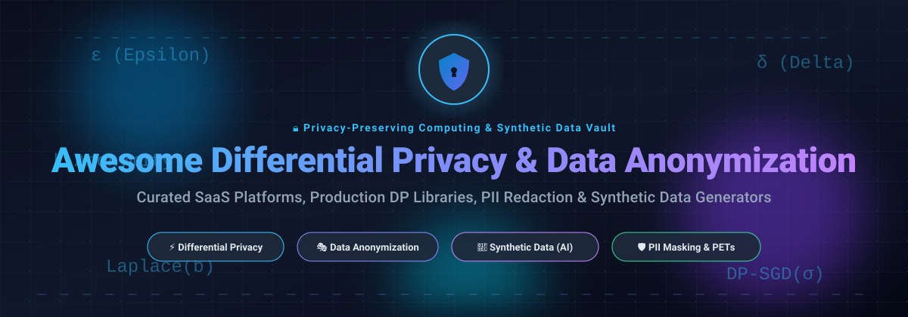

# Awesome Differential Privacy & Data Anonymization 🛡️

 

 

  <b>Top Differential Privacy, Data Anonymization & Synthetic Data Solutions 🌟 Star if you like it! 🌟</b> 
  <i>A curated collection of production-grade SaaS platforms and open-source GitHub projects for privacy-preserving AI, PII redaction, differential privacy guarantees, and synthetic data generation.</i>

---

## 📌 Table of Contents

- [🌐 Sector Overview & Market Dynamics](#-sector-overview--market-dynamics)
- [🏢 SaaS & Managed Hosted Platforms](#-saas--managed-hosted-platforms)
- [💻 Open-Source GitHub Projects](#-open-source-github-projects)
- [🤝 How to Contribute](#-how-to-contribute)
- [💖 Support & Sponsorship](#-support--sponsorship)
- [📈 Star History](#-star-history)
- [⚖️ Disclaimer](#️-disclaimer)

---

## 🌐 Sector Overview & Market Dynamics

The global data anonymization, privacy-enhancing technologies (PETs), and synthetic data generation market is estimated between **$1.3B to $5.5B** in 2025–2026, expanding at an aggressive CAGR of 30%+ driven by generative AI training workloads and tightening privacy compliance regimes (GDPR, EU AI Act, CCPA, HIPAA). 

The sector is **moderately to highly fragmented** rather than winner-take-all, characterized by niche specialists across data modalities (tabular, unstructured text, healthcare records, time-series, relational databases) and deployment boundaries (multi-tenant cloud SaaS vs. air-gapped sovereign enclaves), alongside active strategic acquisitions by enterprise data cloud and AI platform providers (e.g., Snowflake, Informatica/Salesforce, Nvidia).

---

## 🏢 SaaS & Managed Hosted Platforms

| Platform | Company Scale / Valuation / Revenue | Starting Pricing Tier | Free Tier Limits / Trial Limits | Description & Best For |
| :--- | :--- | :--- | :--- | :--- |
| **Snowflake Differential Privacy** | **$55B–$65B+ Market Cap** (~$3.6B ARR) | **$2.00–$3.00/credit** (Standard/Enterprise compute tiers, consumption-based) | **30-day free trial** with **$400 in free usage credits** (whichever expires first) | Native DP within Snowflake Data Clean Rooms. Best for Snowflake customers requiring entity-level differential privacy in multi-party clean room analytics. |
| **Privitar** *(Informatica)* | **Acquired by Informatica** (~$8B Salesforce deal; $1.6B+ ARR; Privitar was valued at ~$250M–$400M) | Enterprise contract via sales (historically custom scoping; typically starting at tens of thousands annually) | **Demo on request** (no self-serve free tier or public trial period; 14-to-30 day scoped enterprise pilot upon request) | Sensitive data provisioning, de-identification, and privacy governance. Best for large enterprises requiring policy-driven compliance and data masking. |
| **Gretel.ai** *(Nvidia)* | **Acquired by Nvidia** for **>$320M+ Valuation** (~$14.6M ARR; $67M+ VC raised) | **Team tier at $295/month** (pooled credits, 10 concurrent jobs); **$2.00/credit** pay-as-you-go | **Free forever plan**: **15 credits/month** (refreshed monthly, max 2 concurrent workers; ~100K synthetic records or ~2M PII detection records) | Managed synthetic data generation with DP and PII redaction for tabular, text, and time-series data. Best for teams wanting full-lifecycle synthetic data APIs. |
| **Tonic.ai** | **$100M–$250M Valuation** (~$16M–$18M ARR; $45M raised) | **Starter tier from $29/month** (includes $25 usage credits); pay-as-you-go metering for additional compute | **Free forever plan**: **$5 in monthly usage credits** (~9 complex synthesis sessions; no credit card required) | Realistic test data generation, relational synthesis, and differential privacy de-identification for developer databases. Best for test data management. |
| **K2View** | **$100M–$250M Valuation** (~$20M–$36M ARR; $43M+ growth capital raised) | **From £1,000/year (~$1,300/yr)** starting tier per catalog listing; enterprise custom tiers | **30-day free trial** (for cloud iPaaS / data integration platform evaluation) | Operational data product platform featuring micro-databases and built-in anonymization/tokenization. Best for real-time customer data synthesis. |
| **Mostly AI** | **~$50M–$100M Est. Valuation** (~$15M–$17M ARR; $25M+ raised) | Enterprise plans require sales quote; credit packs starting from pay-as-you-go tiers | **Free forever plan**: **2 credits refreshed daily** (auto top-up every 24h, designed for persistent developer experimentation) | High-fidelity tabular synthetic data generation with differential privacy guarantees. Best for BFSI and healthcare tabular dataset generation. |
| **Hazy** | **~$50M–$100M Est. Valuation** (~$3M ARR; $11.3M raised) | **Developer tier from $100/month**; enterprise licensing for on-prem/private cloud | **Free forever tier**: up to **100,000 rows/day** for developer experimentation | Synthetic data replicas built for regulated banking, telecom, and insurance institutions. Best for teams with predictable, mid-scale daily generation. |
| **Synthesized** | **~$30M–$60M Est. Valuation** (~$3M–$5M ARR; $30M+ raised including 2025 Series A) | **Free SDK / Solo Edition** ($0); Enterprise platform custom licensing | **Free forever SDK & Solo Edition**: unlimited generative models, datasets, and built-in DP guarantees for solo/dev workloads | Synthetic data SDK and agentic test infrastructure with mathematical differential privacy guarantees. Best for developers wanting self-hosted DP generation. |
| **Statice** *(PwC Germany)* | **Strategic acquisition by PwC Germany** (~$1M ARR; $6M+ early funding) | Custom enterprise licensing / pilot scoping | **Trial upon request**: Scoped POC pilot (typically 14 to 30 days guided evaluation, no self-serve free tier) | Irreversible synthetic data generation and data anonymization adhering to European GDPR standards. Best for enterprise compliance workflows. |
| **LeapYear** *(Acquired by Snowflake)* | **Acquired by Snowflake** (prior $35M+ funding; technology integrated into Snowflake DP) | Integrated into Snowflake platform consumption pricing | **Integrated into Snowflake**: 30-day trial with $400 credits via Snowflake | Pioneer in differential privacy algorithms; standalone platform sunsetted post-acquisition and embedded directly into Snowflake Data Clean Rooms. |

---

## 💻 Open-Source GitHub Projects

Curated open-source projects providing self-hosted differential privacy, data masking, PII de-identification, and synthetic dataset generation. Sorted by GitHub star count (descending).

- ### **[Microsoft Presidio](https://github.com/microsoft/presidio)**  🛡️
  **Context-aware PII detection, redaction, and de-identification engine** *(MIT License)*  
  - **Overview**: An enterprise-grade, extensible framework created by Microsoft to detect, redact, and anonymize sensitive PII (personally identifiable information) entities in text, semi-structured tables, and images.
  - **Key Features**: Customizable rule/pattern recognizers, deep-learning NLP NER models, multi-language support, pseudonymization, hashing, and synthetic surrogate token replacement.
  - **Tech Stack & Deployment**: Python, C#, Docker, Kubernetes, REST API. `pip install presidio-analyzer presidio-anonymizer`.
  - **Best For**: Automated end-to-end PII de-identification pipelines in document databases, customer conversations, and AI prompting.

- ### **[Synthetic Data Vault (SDV)](https://github.com/sdv-dev/SDV)**  🧬
  **Ecosystem for synthetic tabular, relational, and multi-table data** *(Business Source License / Community Open)*  
  - **Overview**: The most popular Python generative data modeling ecosystem for single-table, multi-table relational databases, and sequential/time-series datasets.
  - **Key Features**: Copula-based statistical models, deep generative architectures (CTGAN, TVAE), constraints engine, relational referential integrity preservation, and benchmark quality reporting.
  - **Tech Stack & Deployment**: Python. `pip install sdv`.
  - **Best For**: Data science teams needing production-scale synthetic relational test data without exposing sensitive real-world tables.

- ### **[Google Differential Privacy](https://github.com/google/differential-privacy)**  🔒
  **Google's reference production differential privacy library** *(Apache 2.0)*  
  - **Overview**: Industrial-strength libraries from Google implementing foundational $(\epsilon, \delta)$-differential privacy algorithms used across Google products.
  - **Key Features**: Core DP mechanisms (Laplace, Gaussian), bounded statistics (sums, counts, percentiles), differential privacy SQL engines, and *Privacy on Beam* for large-scale Apache Beam pipelines.
  - **Tech Stack & Deployment**: C++, Go, Java, Python (PipelineDP).
  - **Best For**: Enterprise engineers building highly scalable, mathematically audited differential privacy pipelines for big data analytics.

- ### **[SecretFlow](https://github.com/secretflow/secretflow)**  🌐
  **Unified framework for privacy-preserving data analysis and ML** *(Apache 2.0)*  
  - **Overview**: A comprehensive open-source privacy framework orchestrating differential privacy, multi-party computation (MPC), federated learning, and Trusted Execution Environments (TEEs).
  - **Key Features**: Differentially private model training, secure multi-party private set intersection (PSI), split learning, and privacy-preserving SQL computation across distrusting organizations.
  - **Tech Stack & Deployment**: Python, C++. Self-hosted cluster or local deployment.
  - **Best For**: Enterprises co-training AI models or performing joint analytics across regulated institutions without centralized data sharing.

- ### **[Opacus (PyTorch)](https://github.com/pytorch/opacus)**  🧠
  **High-speed DP-SGD training for deep learning models in PyTorch** *(Apache 2.0)*  
  - **Overview**: Meta's standard library for training deep learning models with differential privacy guarantees directly in PyTorch.
  - **Key Features**: DP-SGD (Differentially Private Stochastic Gradient Descent), vectorization over mini-batches for GPU acceleration, privacy accounting (Rényi Differential Privacy / Gaussian mechanisms), and Hugging Face transformer compatibility.
  - **Tech Stack & Deployment**: Python, PyTorch. `pip install opacus`.
  - **Best For**: Machine learning researchers and AI practitioners training vision or NLP foundation models with mathematical privacy against data reconstruction attacks.

- ### **[Greenmask](https://github.com/GreenmaskIO/greenmask)**  🎭
  **PostgreSQL & database logical dump anonymization tool** *(Apache 2.0)*  
  - **Overview**: High-performance, stateless database masking and synthetic data generator designed to integrate into PostgreSQL logical backup pipelines (`pg_dump`).
  - **Key Features**: In-flight transformation, deterministic pseudonymization, synthetic noise injection, referential integrity preservation across foreign key cycles, and database subsetting.
  - **Tech Stack & Deployment**: Go CLI binary, Docker. Zero database overhead.
  - **Best For**: DevOps and platform engineers automatically sanitizing staging and dev test databases from production dumps.

- ### **[CTGAN](https://github.com/sdv-dev/CTGAN)**  📊
  **Conditional Generative Adversarial Network for tabular data** *(Apache 2.0 / MIT)*  
  - **Overview**: Deep learning synthetic data generator designed specifically for tabular records with mixed continuous, categorical, and skewed distributions.
  - **Key Features**: Mode-specific normalization for multi-modal numeric columns, conditional generator architecture, and tabular variational autoencoder (TVAE) alternatives.
  - **Tech Stack & Deployment**: Python, PyTorch. `pip install ctgan`.
  - **Best For**: Researchers and data teams synthesizing tabular datasets with complex cross-column dependencies.

- ### **[IBM Diffprivlib](https://github.com/IBM/differential-privacy-library)**  📦
  **General-purpose differential privacy library with scikit-learn ML models** *(MIT License)*  
  - **Overview**: A mature, developer-friendly Python library developed by IBM for differential privacy analytics and drop-in machine learning.
  - **Key Features**: DP Laplace/Gaussian/exponential noise mechanisms, DP scikit-learn models (logistic regression, naive Bayes, PCA, k-means, decision trees), DP histogram/mean statistics, and privacy budget accounting.
  - **Tech Stack & Deployment**: Python. `pip install diffprivlib`.
  - **Best For**: Data scientists seeking drop-in DP replacements for scikit-learn estimators and basic statistical aggregation.

- ### **[ARX Data Anonymizer](https://github.com/arx-deidentifier/arx)**  🏛️
  **Comprehensive open-source de-identification and risk evaluation suite** *(Apache 2.0)*  
  - **Overview**: Highly respected academic and industrial software for biomedical and enterprise data anonymization.
  - **Key Features**: Multi-model privacy protection: supports $k$-anonymity, $\ell$-diversity, $t$-closeness, $\delta$-presence, and $(\epsilon, \delta)$-differential privacy; re-identification risk analysis and utility metric optimization.
  - **Tech Stack & Deployment**: Java, Desktop GUI, Cross-platform CLI, and Java API.
  - **Best For**: Healthcare, clinical trials, and government data stewards who require audited risk assessments alongside syntactic and differential privacy.

- ### **[OpenMined PyDP](https://github.com/OpenMined/PyDP)**  🐍
  **Python bindings for Google's differential privacy library** *(Apache 2.0)*  
  - **Overview**: Developed by the OpenMined community, PyDP provides idiomatic Python bindings to Google’s high-performance C++ Differential Privacy primitives.
  - **Key Features**: Bounded differential privacy metrics (mean, sum, variance, standard deviation, median, percentiles), noise addition, and budget consumption monitoring.
  - **Tech Stack & Deployment**: Python, C++ bindings. `pip install pydp`.
  - **Best For**: Python programmers wanting the audited safety of Google's C++ DP core without writing C++.

- ### **[OpenDP Core](https://github.com/opendp/opendp)**  🔬
  **Modular differential privacy library incubated at Harvard University** *(MIT License)*  
  - **Overview**: The foundational library of the OpenDP initiative (Harvard Privacy Tools Project), focused on mathematically verified privacy implementations.
  - **Key Features**: Composable transformations and measurement primitives in Rust with first-class Python and R bindings; formal framework for privacy accounting and privacy loss distributions.
  - **Tech Stack & Deployment**: Rust core with Python (`pip install opendp`) and R packages.
  - **Best For**: Rigorous scientific workflows, public policy research, and production privacy services requiring provably correct DP primitives.

- ### **[OpenDP SmartNoise SDK](https://github.com/opendp/smartnoise-sdk)**  🔔
  **Tools and services for differentially private SQL and synthetic data** *(MIT License)*  
  - **Overview**: Developed in collaboration between Microsoft and OpenDP to bring differential privacy to relational databases and tabular data synthesis.
  - **Key Features**: Differentially private SQL query translation across PostgreSQL, SQL Server, and Spark; includes `smartnoise-synth` for DP tabular synthesis (MWEM, DP-CTGAN, PATE-CTGAN).
  - **Tech Stack & Deployment**: Python. `pip install opendp-smartnoise`.
  - **Best For**: Querying sensitive relational databases with automatic differential privacy noise injection and generating DP synthetic tables.

- ### **[Microsoft dp-transformers](https://github.com/microsoft/dp-transformers)**  🤖
  **Differentially private fine-tuning of Hugging Face Transformers** *(MIT License)*  
  - **Overview**: Bridges PyTorch Opacus and Hugging Face's `transformers` library to fine-tune autoregressive and masked language models with differential privacy.
  - **Key Features**: Efficient gradient clipping for transformer self-attention blocks, privacy accounting for NLP training runs, and drop-in integration with Hugging Face `Trainer`.
  - **Tech Stack & Deployment**: Python, PyTorch, Hugging Face.
  - **Best For**: Fine-tuning LLMs on sensitive internal corpora (medical notes, confidential chat logs) with formal differential privacy bounds.

- ### **[Microsoft Synthetic Data Showcase](https://github.com/microsoft/synthetic-data-showcase)**  🖥️
  **Privacy-preserving synthetic dataset generator and web dashboard** *(MIT License)*  
  - **Overview**: An open-source tool and interactive web UI for generating privacy-preserving synthetic categorical datasets and visual aggregate dashboards.
  - **Key Features**: Generates $k$-anonymous synthetic attribute datasets, private aggregate visualizations, and matrix evaluations directly in the browser or via CLI.
  - **Tech Stack & Deployment**: TypeScript, Python, WebAssembly.
  - **Best For**: Public health agencies, NGOs, and researchers seeking to publish aggregate data visualizations without leaking private individual responses.

- ### **[Microsoft DPSDA (Private Evolution)](https://github.com/microsoft/DPSDA)**  🧪
  **Differentially private synthetic data generation without model training (ICLR 2024)** *(MIT License)*  
  - **Overview**: Implementation of "Private Evolution", a training-free framework that queries pre-trained foundation models (LLMs or diffusion models) via API to produce DP synthetic datasets.
  - **Key Features**: No backpropagation or weight updates required; samples candidate synthetic data and selects optimal candidates under differential privacy noise.
  - **Tech Stack & Deployment**: Python, PyTorch.
  - **Best For**: AI researchers investigating zero-training DP synthetic generation using API-accessible foundation models.

- ### **[OpenDP Tumult Analytics](https://github.com/opendp/tumult-analytics)**  📈
  **Python framework for differentially private data analysis atop Spark** *(Apache 2.0)*  
  - **Overview**: A high-level Python library designed for data analysts to execute complex aggregate queries with rigorous differential privacy guarantees.
  - **Key Features**: Built atop Tumult Core and Apache Spark; privacy budget management, automated noise calibration, and support for complex multi-table joins. Adopted by the U.S. Census Bureau and Wikimedia Foundation.
  - **Tech Stack & Deployment**: Python, Apache Spark. `pip install tmlt.analytics`.
  - **Best For**: Enterprise and government data teams publishing aggregate statistics on massive tabular datasets.

---

## 🤝 How to Contribute

Contributions are warmly welcomed! Please follow these simple guidelines:

1. **Fork the repository** to your personal account.
2. **Add/Edit entries** in `README.md` maintaining consistent formatting, badges, and factual descriptions.
3. **Include essential metadata**:
   - Official name and repository link
   - GitHub stars badge (`style=social&color=white`) linking to the stargazers page
   - License type
   - 2–3 concise sentences outlining core features, tech stack, and best-fit use case.
4. **Submit a Pull Request (PR)** with a clear summary of your additions.

---

## 💖 Support & Sponsorship

If this curated repository saved you time, informed your privacy architecture, or helped your organization choose the right tools:

- 🌟 **Star the repository** to boost discoverability on GitHub!
- 🍴 **Fork and share** with colleagues, privacy engineers, and data science teams!
- ☕ **Buy me a coffee / Become a sponsor**: If you find value in my open-source work and curated awesome-lists, please consider supporting continued maintenance via the [GitHub Sponsor Dashboard](https://github.com/sponsors/ishandutta2007)!

  

---

## 📈 Star History

---

## ⚖️ Disclaimer

- This is a **community-curated collection** intended for research, architectural evaluation, and educational purposes—not an explicit legal or technical endorsement.
- Differential privacy algorithms and anonymization tools handling sensitive customer data must adhere strictly to applicable compliance frameworks (GDPR, HIPAA, CCPA, EU AI Act).
- **Formal mathematical guarantees depend entirely on correct parameter selection ($\epsilon$, $\delta$), noise distribution, sensitivity calibration, and rigorous privacy budget composition.** Always review pipeline implementations with certified privacy engineers.

---

  Maintained with 🛡️ for privacy engineers, AI researchers, and data stewards worldwide.

